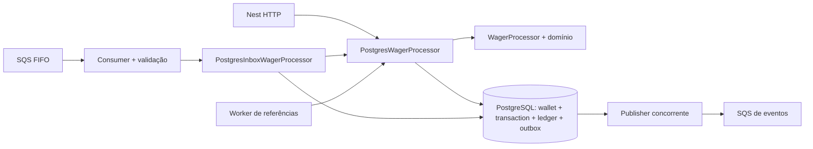
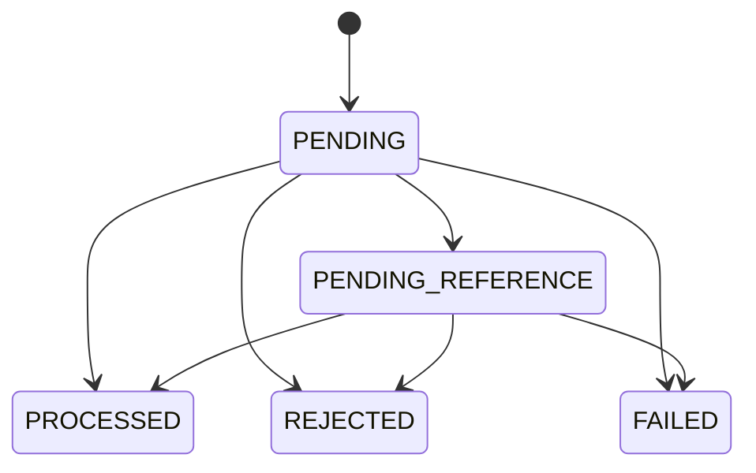

# Decisões de arquitetura

## Fluxo e fronteiras

O domínio contém Money, Wallet, WagerTransaction, WalletLedgerEntry, InboxMessage,
OutboxMessage e subclasses de IntegrationEvent. Factories encapsulam criação,
transições explícitas protegem estado terminal e `rehydrate` reconstrói estado
persistido. O domínio não depende de Nest nem dos records do ORM.

Records + EntitySchema ficam na infraestrutura. Mappers convertem representação
persistida e domínio. MikroORM foi escolhido por tornar Unit of Work, forks,
transações e locks explícitos. DTOs de consulta são projeções, não entidades expostas.

## Dinheiro e ledger

Money usa decimal.js com precisão 40 e limite compatível com `numeric(20,2)`.
Não aceita number, negativos de entrada, NaN, infinito, notação científica ou escala
diferente de duas casas. Operações produzem novas instâncias; resultados internos
assinados são permitidos. Colunas monetárias usam DecimalType string e currency separada.

Wallet inicia na versão 1. A versão muda apenas quando há movimento financeiro.
Saldo inicial positivo gera OPENING, lançamento CREDIT e eventos na mesma transação;
zero não gera movimento. LOSS e rejeições não geram ledger.

O schema protege saldo não negativo, unicidade jogador/moeda, chaves de idempotência,
operação externa, reversão processada por referência/tipo e um lançamento por
wallet/transação. Ledger possui FK composta para transação/wallet/moeda, checks de
aritmética e trigger que rejeita UPDATE, DELETE e TRUNCATE. A unicidade composta na
transação apoia essa FK; não limita a quantidade de OPENING por jogador.

Reconciliação calcula soma de CREDIT menos DEBIT no PostgreSQL. Saldo, soma,
diferença (`stored - calculated`) e contagem são lidos em uma única instrução SQL,
portanto no mesmo snapshot Read Committed. O total e a diferença usam numeric sem
redução a float nem ao limite de uma operação individual; até uma corrupção fora
desse limite continua reportável. Divergências não são reparadas automaticamente.

## Concorrência e atomicidade

A unidade de exclusão é a wallet: `SELECT FOR UPDATE`, isolamento Read Committed.
Uma aposta lê e modifica o saldo enquanto mantém esse lock. Outra operação na mesma
wallet espera o commit e usa o saldo atualizado; wallets distintas não compartilham
um lock global. É uma escolha simples para hot wallets, ao custo de serialização
por wallet; esperas elevam latência. Testes incluem três processos e 50 chamadas paralelas.

`flush()` envia SQL, mas não equivale a commit da transação externa. O processor
persiste transação, saldo, ledger e outbox atomicamente. Na entrada SQS, a inbox
abre a transação externa, e os forks financeiros preservam seu contexto transacional.
Uma falha posterior desfaz inclusive o que já sofreu flush.

Workers de referências bloqueiam primeiro a wallet, depois a transação pendente,
mantendo a ordem dos locks. Referências de outra wallet são lidas para validação,
sem adquirir um segundo lock de wallet. Publishers usam `FOR UPDATE SKIP LOCKED`
por registro de outbox, permitindo trabalho concorrente.

## Idempotência

Há duas constraints únicas: `idempotency_key` global e `(provider_id, external_transaction_id)`.
O SHA-256 usa JSON construído com campos de negócio em ordem explícita alfabética:
externalTransactionId, gameId, kind, money (amount/currency), playerId, providerId,
referenceExternalTransactionId, roundId e walletId. Ausência de referência é omitida.
UUIDs HTTP/SQS são normalizados para minúsculas e Money mantém escala fixa.

O header é obrigatório no HTTP e prevalece sobre eventual campo de mesmo nome no
body. ID interno, header, correlationId, messageId e demais metadados não entram no hash.
Replay exige a mesma key e hash. Outra key para a mesma operação externa é conflito.
Há uma busca inicial, outra após obter o lock e tratamento das constraints para
disputas entre wallets/instâncias. O banco é a garantia final.

O resultado persistido inclui saldo e moeda observados. Replay de resultado terminal
não consulta o saldo atual para recompor a resposta. PENDING_REFERENCE ainda pode
evoluir; sua resolução grava o resultado final que passa a ser estável.

## Referências e estados

PROCESSED, REJECTED e FAILED são terminais no domínio. O fluxo normal persiste
rejeições de negócio; falhas transitórias deixam a transação SQL sofrer rollback.
FAILED/PERMANENT_INFRASTRUCTURE_ERROR existe no modelo para uma decisão permanente
auditável. Não se inventa um registro FAILED durante indisponibilidade do banco:
após esgotamento no transporte, a auditoria desse erro fica na DLQ, com corpo e motivo.

Referências são resolvidas por provedor + ID externo e validadas por player,
wallet, moeda e rodada. REFUND aceita BET; ROLLBACK aceita BET, WIN ou REFUND.
WIN pode referenciar BET. Reversão deve ter valor integral e não se repetir pelo
mesmo tipo. Reversão que deixaria saldo negativo tem failureCode próprio.

Referência ausente fica persistida e o ack pode ocorrer: o worker do banco assume
a pendência, evitando bloquear uma referência posterior no mesmo grupo FIFO.
São até 10 tentativas agendadas, com atraso exponencial e teto de 60 segundos.
A primeira espera é 1 segundo; sem indisponibilidade, a janela é aproximadamente
303 segundos mais o tempo de polling. É limite de tentativas, não TTL absoluto:
tempo com worker parado estende a janela. Esgotamento produz REJECTED/REFERENCE_NOT_FOUND
e evento. A agenda, tentativas e rastreamento sobrevivem ao reinício.

## Inbox, SQS e falhas

Taxonomia persistida em `failureCode`:

| Código | Significado |
|---|---|
| `INSUFFICIENT_BALANCE` | BET sem saldo suficiente |
| `INSUFFICIENT_BALANCE_FOR_REVERSAL` | Reversão de crédito deixaria saldo negativo |
| `REFERENCE_NOT_FOUND` | Limite de resolução de referência esgotado |
| `INVALID_REFERENCE` | Contexto, tipo, valor ou estado da referência incompatível |
| `ALREADY_REVERSED` | Referência já revertida por esse tipo de operação |
| `WALLET_MISMATCH` | Wallet da operação incompatível |
| `PLAYER_MISMATCH` | Jogador não corresponde à wallet |
| `CURRENCY_MISMATCH` | Moeda da operação difere da wallet |
| `MONETARY_LIMIT_EXCEEDED` | Movimento ultrapassaria o limite monetário |
| `PERMANENT_INFRASTRUCTURE_ERROR` | Falha permanente representável pelo estado FAILED |

FIFO agrupa por wallet nos exemplos, mas é otimização. Duas entregas SQS diferentes
com o mesmo messageId de negócio encontram a mesma inbox `(consumerName,messageId)`.
Hash divergente da inbox é conflito. Outra entrega do mesmo negócio também encontra
a idempotência financeira, mesmo com messageId diferente.

Ack usa o receiptHandle atual e acontece após o commit externo. Erro no ack transporta
o resultado já confirmado; a reentrega não repete os efeitos. Heartbeat renova a
visibilidade enquanto há processamento e é encerrado antes de aplicar retry.
SIGTERM aborta long polling e conclui a operação em andamento; mensagens recebidas
antes de começar o processamento podem ter visibilidade devolvida.

Erros de validação e conflitos permanentes vão para DLQ. Erros desconhecidos são
tratados como transitórios: até 5 recebimentos, atrasos 1/2/4/8 segundos e DLQ no quinto.
Wallet ainda inexistente pode se beneficiar desse retry limitado. Rejeição de negócio
é terminal com ack; PENDING_REFERENCE também recebe ack após persistir a agenda.
A DLQ recebe o corpo original e atributos de motivo/origem/tentativa; só depois de
confirmar o envio a origem é removida. Falha no envio preserva a origem. O broker
também tem redrive configurado como proteção; nesse caminho os atributos manuais
de diagnóstico podem não existir.

## Outbox e publicação

Eventos versionados contêm MoneyProps em JSON e eventId estável. O publisher só
enxerga linhas confirmadas. Mantém lock do registro durante um envio limitado a
10 segundos; isso simplifica a posse entre publishers, ao custo de manter uma
transação SQL durante I/O. Falha agenda retry exponencial de 1 segundo até 5 minutos,
sem descartar o evento por limite de tentativas.

Se o envio foi aceito e o processo caiu antes de marcar a publicação, haverá novo
envio com o mesmo eventId. A entrega é at-least-once, não exactly-once. A deduplicação
FIFO é temporária; consumidores dos eventos devem deduplicar persistentemente por
eventId. Os testes verificam recuperação e preservação desse identificador.

## Operação, métricas e limites

API e cada worker expõem seu registro Prometheus. Contadores são operacionais e
podem perder uma observação em uma queda entre commit e incremento; a auditoria
financeira está no PostgreSQL. Não se usam contadores como garantia de idempotência.
Labels têm conjuntos limitados; IDs individuais ficam nos logs. O lag da outbox é
consultado no banco ao coletar métricas do publisher e inclui eventos aguardando retry.
Uma nova instância recupera esse lag mesmo com contadores zerados.

Migrations são o mecanismo de evolução do schema; não há schema sync automático.
O Compose espera a preparação terminar, oferece shutdown gracioso e permite escalar
consumidores com portas de métricas dinâmicas. Os testes financeiros usam banco e
broker reais e recursos isolados. O LocalStack local é efêmero; resiliência a perda
do armazenamento do próprio broker não é simulada por recriação desse container.

Autenticação completa foi adiada para priorizar correção financeira, conforme a
seção 2 do desafio. `ProviderIdentityGuard` está aplicado aos endpoints financeiros
e de consulta e atualmente permite chamadas. A evolução prevista usa Keycloak ou
outro IdP OIDC, valida assinatura/issuer/audience/expiração do JWT e associa a
identidade autorizada ao providerId. Health permanece aberto; SQS é canal interno
com validação de domínio. Não há tabela própria de usuários/senhas.

Ficam fora da entrega: IdP configurado, partidas dobradas, dashboards, OpenTelemetry
e teste de carga. Nenhum deles é obrigatório no enunciado.
